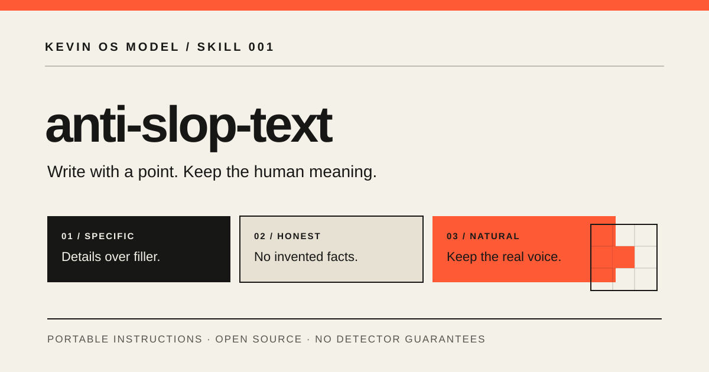

# Kevin OS Model

<p align="center">
  
</p>

An open collection of reusable instructions, workflows, and practical resources for working with AI models.

**The goal:** resources that are readable, useful, testable, and honest about their limitations. The repository is provider-agnostic by design, but native installation and results still depend on each model and product.

<p align="center">
  <a href="CATALOG.md">Browse resources</a> ·
  <a href="CONTRIBUTING.md">Contribute</a> ·
  <a href="docs/COMPATIBILITY.md">Compatibility</a>
</p>

## Start here

### [anti-slop-text](anti-slop-text/SKILL.md)

A practical writing workflow for reducing generic, repetitive, inflated, and formulaic text while preserving meaning, evidence, and the writer's voice.

<p align="center">
  
</p>

| Resource | What it is |
|---|---|
| [Main skill](anti-slop-text/SKILL.md) | Main instructions and workflow |
| [Patterns reference](anti-slop-text/references/patterns.md) | Common weak-writing patterns and how to diagnose them |
| [Review checklist](anti-slop-text/references/review-checklist.md) | A practical editorial pass |
| [Examples](anti-slop-text/references/examples.md) | Before-and-after examples |
| [Evaluation cases](anti-slop-text/evals/evaluation-cases.md) | Repeatable cases for checking behavior |

## Use a resource with your AI

The skill uses a Markdown `SKILL.md` structure inspired by the Agent Skills format.

1. Open the skill's `SKILL.md`.
2. If your AI product supports skills, follow that product's own installation instructions.
3. If it does not support native skills, provide the file as context or adapt it to custom instructions when available.
4. Try the evaluation cases on your chosen model and note what works or fails.

A folder containing `SKILL.md` is **not** automatically installable in every AI chat app. Plain Markdown makes the instructions portable; it does not guarantee identical behavior across products.

## Repository map

```text
.
├── assets/                  # Project logo, favicon, banners, skill artwork
├── anti-slop-text/
│   ├── SKILL.md             # Main skill instructions
│   ├── references/          # Supporting editorial guidance
│   └── evals/               # Repeatable evaluation cases
├── docs/
│   ├── PROJECT_STRUCTURE.md
│   ├── COMPATIBILITY.md
│   └── QUALITY_STANDARD.md
├── CATALOG.md               # Resource index
├── TEMPLATE_SKILL.md        # Starting point for new skills
├── CONTRIBUTING.md
├── CODE_OF_CONDUCT.md
├── SECURITY.md
├── SUPPORT.md
└── LICENSE
```

## Quality over claims

- No promises of “100% anti-slop,” guaranteed detector results, or perfect performance on every model.
- No invented sources, benchmark results, capabilities, or compatibility claims.
- Prefer focused workflows, concrete examples, and repeatable evaluations over extra files that add no practical value.
- Record which model, version, method, and date were actually tested.

See the [compatibility guide](docs/COMPATIBILITY.md) and [resource quality standard](docs/QUALITY_STANDARD.md) for the full policy.

## Contributing

Suggestions, reproducible issues, examples, and new focused resources are welcome. Before opening a contribution, review [CONTRIBUTING.md](CONTRIBUTING.md) and use the [skill template](TEMPLATE_SKILL.md) when appropriate.

## License

The repository uses the [MIT License](LICENSE) unless a resource contains a more specific license or attribution notice.
