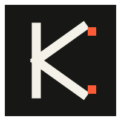

<p align="center">
  
</p>

<p align="center">
  
</p>

<p align="center">
  <strong>Kevin OS Model</strong><br/>
  Open source skills for Claude & Grok<br/>
  Maintained by <strong>Kevin</strong> (<code>@lausiapempruy</code>)
</p>

---

## What is this?

A collection of modular skills built specifically for **Claude** and **Grok**.

Each skill is self-contained. Copy the `SKILL.md`, drop it into your system prompt / project instructions, and it works.

No frameworks. No bloat. Just clear instructions that change how the model behaves.

---

## Available Skills

| | Skill | What it does | Status |
|---|-------|--------------|--------|
|  | [anti-web-slop](skills/anti-web-slop/) | Blocks AI-generated and generic web design patterns. 100-point checklist. | Ready |

---

## How to use

**Grok**  
Copy the content of any `SKILL.md` into your system prompt or custom instructions.

**Claude**  
Create a Project → paste the `SKILL.md` as Custom Instruction or Knowledge.

That’s it.

---

## Repository structure

```
kevin-os-model/
├── assets/               # Logos, icons, banners (SVG)
├── skills/
│   └── anti-web-slop/
│       ├── SKILL.md
│       ├── icon.svg
│       └── references/
│           ├── ai-slop.md
│           └── generic-slop.md
├── CONTRIBUTING.md
├── LICENSE
└── README.md
```

---

## Contributing

Want to add a skill? Read [CONTRIBUTING.md](CONTRIBUTING.md).

Keep it specific. Keep it useful. Avoid vague “AI assistant” fluff.

---

## License

MIT

---

<p align="center">
  
  &nbsp;Kevin OS Model
</p>